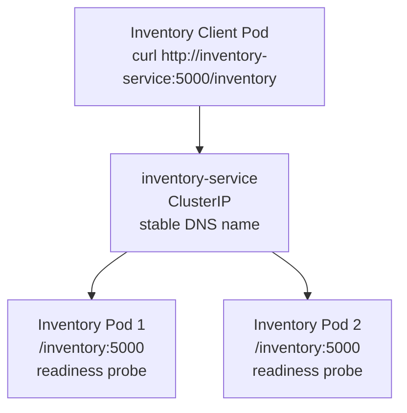
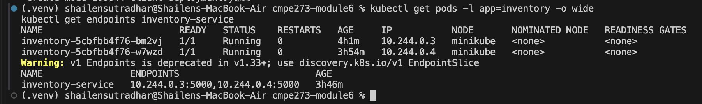
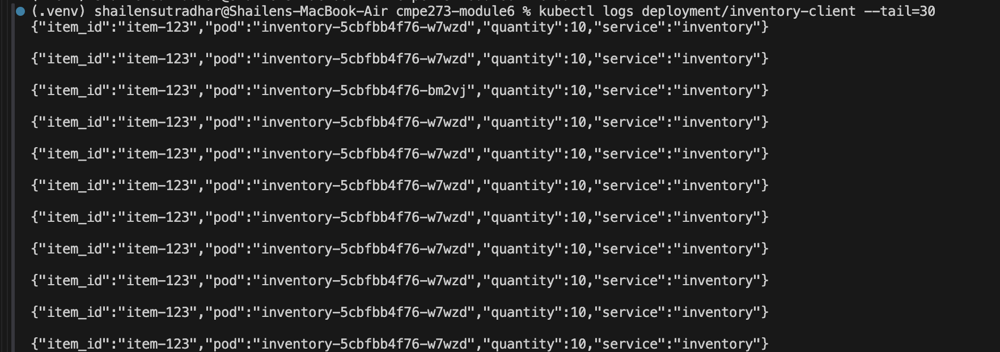
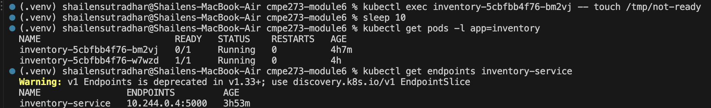
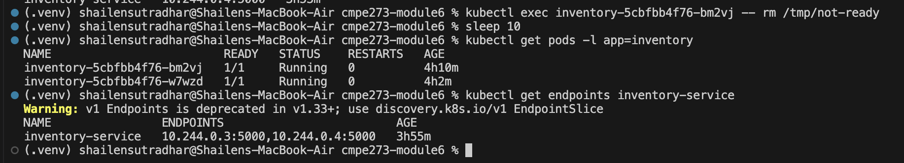
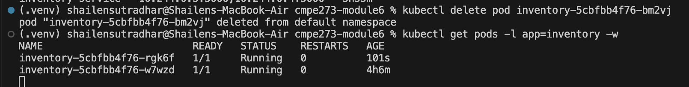
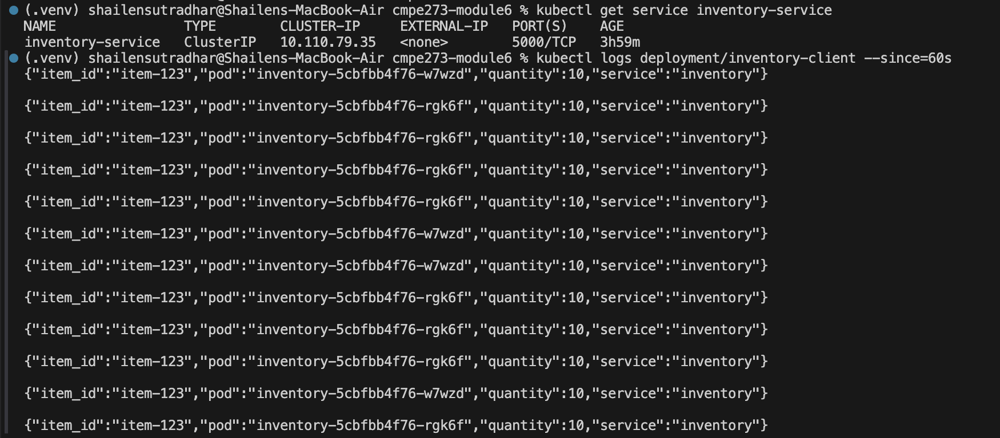

# Module 6 Assignment: Service Discovery, Readiness & Recovery

This project deploys an Inventory service on Kubernetes with two replicas and a client that communicates with the service through its Kubernetes Service name.

## Architecture



The client does not use individual Pod IP addresses. Kubernetes DNS resolves `inventory-service` to the ClusterIP, and the Service forwards requests to ready Inventory Pods.

## Project files

- `app.py` - Flask Inventory application with inventory, health, and readiness endpoints.
- `Dockerfile` - Builds the Inventory container image.
- `inventory-deployment.yaml` - Deploys two Inventory replicas with readiness and liveness probes.
- `inventory-service.yaml` - Creates the `inventory-service` ClusterIP Service.
- `client-deployment.yaml` - Runs one client Pod that repeatedly calls the Inventory Service.
- `screenshots/` - Terminal evidence from the deployment and recovery tests.

## Prerequisites

- Docker
- Minikube
- `kubectl`

These commands use Minikube, but the Kubernetes manifests can also be used with another local Kubernetes cluster after making the image available to that cluster.

## Deploy the application

From the repository directory, start Minikube and build the Inventory image:

```bash
minikube start
docker build -t inventory-service:1.0 .
minikube image load inventory-service:1.0
```

Apply the Kubernetes resources:

```bash
kubectl apply -f inventory-deployment.yaml
kubectl apply -f inventory-service.yaml
kubectl apply -f client-deployment.yaml
```

Wait for the Deployments to become ready:

```bash
kubectl rollout status deployment/inventory
kubectl rollout status deployment/inventory-client
```

Check the Pods and Service endpoints:

```bash
kubectl get pods -o wide
kubectl get endpoints inventory-service
```

The Inventory Deployment should have two ready Pods, and the Service should list two endpoint addresses. Kubernetes may display a deprecation warning for `kubectl get endpoints` on newer versions; the output still shows the Service endpoints. The newer equivalent is:

```bash
kubectl get endpointslice -l kubernetes.io/service-name=inventory-service
```

## Evidence 1: Two replicas and Service discovery

The following output shows two Inventory Pods in the `Running` state, both ready as `1/1`. It also shows that `inventory-service` has two endpoints, one for each replica.



The client is configured to call the stable Kubernetes DNS name:

```text
http://inventory-service:5000/inventory
```

## Evidence 2: Requests reach both replicas

The Inventory response includes the serving Pod hostname. The client log below contains responses from both `inventory-5cbfbb4f76-w7wzd` and `inventory-5cbfbb4f76-bm2vj`, demonstrating that the Service distributes requests across more than one replica.

```bash
kubectl logs deployment/inventory-client --tail=30
```



## Evidence 3: Readiness failure

The application readiness endpoint returns HTTP 503 when `/tmp/not-ready` exists. This allows one Pod to remain running while being removed from the Service's ready endpoints.

The test was performed with:

```bash
kubectl exec inventory-5cbfbb4f76-bm2vj -- touch /tmp/not-ready
kubectl get pods -l app=inventory
kubectl get endpoints inventory-service
```

The selected Pod remains `Running`, but its readiness changes to `0/1`. The Service lists only the other ready Pod as an endpoint.



The client can continue to receive normal traffic from the remaining ready replica while the failed-readiness Pod is excluded from the Service.

## Evidence 4: Readiness recovery

Readiness was restored by removing the marker file:

```bash
kubectl exec inventory-5cbfbb4f76-bm2vj -- rm /tmp/not-ready
kubectl get pods -l app=inventory
kubectl get endpoints inventory-service
```

The Pod returned to `1/1`, and both Pod addresses were added back to the Service endpoints.



## Evidence 5: Pod deletion and replacement

One Inventory Pod was deleted:

```bash
kubectl delete pod inventory-5cbfbb4f76-bm2vj
kubectl get pods -l app=inventory -w
```

The Deployment controller created a replacement Pod named `inventory-5cbfbb4f76-rgk6f`. The replacement has a different Pod identity, while the Service name remains `inventory-service`.



## Evidence 6: Client continues after recovery

After replacement, the client continued calling the same Service name:

```bash
kubectl get service inventory-service
kubectl logs deployment/inventory-client --since=60s
```

The logs show successful responses from both the surviving Pod and the replacement Pod.



## Reflection

A stable Kubernetes Service name is useful because clients do not need to know the changing IP addresses or names of individual Pods. When a Pod fails or is replaced, the Service automatically updates its ready endpoints while keeping the same DNS name. This lets the client continue sending requests without configuration changes or awareness of Pod recovery. Readiness probes further ensure that traffic is sent only to Pods that are able to serve requests.

## Cleanup

To remove the resources after testing:

```bash
kubectl delete -f client-deployment.yaml
kubectl delete -f inventory-service.yaml
kubectl delete -f inventory-deployment.yaml
```
